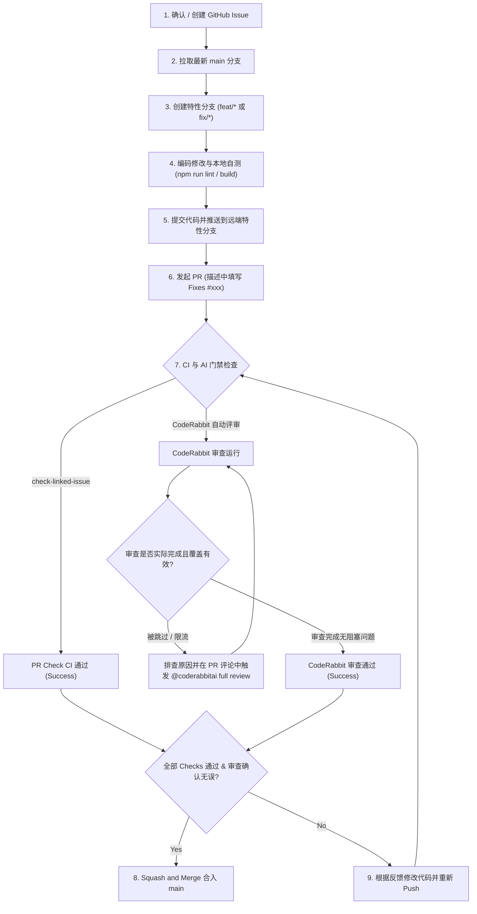

# Agent 协作与研发交付规范 (Agent.md)

本文档定义了本仓库（`wow-addon-web`）中 AI Agent 与开发者的协作规范、分支管理策略、Issue 关联要求及 CodeRabbit AI 代码审查流程。所有参与本项目的 Agent 和开发者必须严格遵守本规范。

---

## 目录
- [一、核心准则](#一核心准则)
- [二、分支管理规范](#二分支管理规范)
- [三、Issue 关联规范](#三issue-关联规范)
- [四、CodeRabbit AI 审查规范](#四coderabbit-ai-审查规范)
- [五、标准研发流程 (端到端)](#五标准研发流程-端到端)
- [六、质量门禁与 CI/CD 机制](#六质量门禁与-cicd-机制)
- [七、CodeRabbit 状态检查与常见问题排查](#七coderabbit-状态检查与常见问题排查)

---

## 一、核心准则

1. **零直接推送**：严禁直接向 `main` 分支推送或提交代码，所有代码必须通过 Pull Request (PR) 合入。
2. **Issue 驱动**：每个 PR 必须明确关联一个已存在的真实 GitHub Issue，杜绝无据可依的代码改动。
3. **AI 审核门禁**：每个 PR 必须由 CodeRabbit AI 进行全量代码评审，并在确认审查实际完成且无阻塞意见后方可合入。
4. **自测通过**：在提交 PR 前，本地必须通过构建与代码规范检查（`npm run lint` & `npm run build`）。

---

## 二、分支管理规范

### 1. 分支保护机制
- **本地拦截**：通过 `.githooks/pre-push` 钩子，阻止直接执行 `git push origin main`。
- **本地钩子启用步骤**：
  1. 新克隆项目后运行 `npm install`（会自动触发 `package.json` 中的 `prepare` 脚本设置 `core.hooksPath` 为 `.githooks`）。
  2. 或手动执行启用命令：
     ```bash
     git config core.hooksPath .githooks
     ```
  3. 执行如下命令验证配置是否生效（需确保实际值为 `.githooks`；若当前配置为其他路径，请调整为 `.githooks` 或将本仓库钩子整合进去）：
     ```bash
     [ "$(git config --get core.hooksPath)" = ".githooks" ] && echo "✅ Hooks path is .githooks" || git config core.hooksPath .githooks
     ```
- **远程分支保护**：GitHub `main` 分支开启了严格分支保护规则（包括管理员），仅允许通过符合门禁要求的 PR 方式合入。

### 2. 分支命名规则
所有改动需从最新的 `main` 分支拉取独立分支，命名规范如下：
- 特性开发：`feat/<feature-name>`，例如 `feat/addon-auto-update`
- 缺陷修复：`fix/<bug-name>`，例如 `fix/parse-toc-encoding`
- 文档更新：`docs/<doc-name>`，例如 `docs/update-agent-guide`
- 重构优化：`refactor/<component>`，例如 `refactor/locale-loader`
- 基础设施/配置：`chore/<task-name>`，例如 `chore/update-dependencies`

---

## 三、Issue 关联规范

为保证代码改动的可追溯性，PR 与 Issue 之间必须建立强关联。

### 1. 关联语法
在提交 PR 时，**必须在 PR 描述（Description）** 中包含以下 GitHub 识别的关联关键字及 Issue 编号，或在页面侧边栏手动关联（**请勿仅写在 PR 标题中，GitHub 标题不会触发 Issue 关联与自动关闭**）：
- `Fixes #<Issue编号>`（如 `Fixes #42`）
- `Closes #<Issue编号>`（如 `Closes #42`）
- `Resolves #<Issue编号>`（如 `Resolves #42`）
- 或在 GitHub PR 页面右侧栏的 **Development** 部分手动点击并链接对应的 Issue。

### 2. 自动化门禁校验
仓库配置了 GitHub Actions 工作流 `.github/workflows/pr-check.yml`：
- 在 PR 打开、编辑、重新打开或推送代码时触发。
- 优先通过 GitHub GraphQL API 查询 `closingIssuesReferences` 获取真实关联的 Issue。
- 若 GraphQL 未能获取，工作流将对 PR 描述进行正则匹配，并通过 GitHub REST API 验证所引用的 Issue 真实存在。
- **若未检测到有效关联的 Issue，CI 校验直接失败**，阻断合并按钮。

> [!NOTE]
> 门禁检查通过仅代表满足语法与关联规则，合并前请评审人员再次确认关联的 Issue 与本改动实际对应。

---

## 四、CodeRabbit AI 审查规范

本项目接入 CodeRabbit AI 作为自动化代码评审员。

### 1. 配置文件
仓库根目录包含 `.coderabbit.yaml`：
- **审查语言**：全中文输出 (`language: "zh-CN"`)。
- **审查概要**：生成高阶变更摘要与 Walkthrough 导读。
- **状态检查**：CodeRabbit 会自动在 PR 中生成名为 `CodeRabbit` 的 Commit Status Check，作为 GitHub 分支保护的必需检查项。

### 2. 交互式审查与对话
- 开发者与 Agent 可在 PR 评论中直接 `@coderabbitai` 进行交互（例如请求重新审查、询问重构建议或澄清问题）。
- 当向分支追加提交时，CodeRabbit 会自动触发增量复审并更新状态。

---

## 五、标准研发流程 (端到端)

对于 AI Agent 或人类开发者，执行任务的标准流程如下：



> [!IMPORTANT]
> **合并前确认审查实际完成**：
> GitHub 分支保护可能会将跳过（Skipped）或限流（Rate-limited）状态视为检查通过。因此在点击合并前，必须人工或流程确认 CodeRabbit **实际完成了有效审查**，且没有遗留的高风险待解决评论。若审查被跳过，可在 PR 中评论 `@coderabbitai full review` 重新触发。

### 详细步骤命令示范

```bash
# 步骤 1：同步并切换到最新 main 分支，确认本地 hooks 路径正确设置为 .githooks
git checkout main
git pull origin main
[ "$(git config --get core.hooksPath)" = ".githooks" ] || git config core.hooksPath .githooks

# 步骤 2：创建特性分支
git checkout -b feat/add-addon-search

# 步骤 3：完成编码开发后本地自查
npm run lint
npm run build

# 步骤 4：提交代码
git add .
git commit -m "feat: implement addon search and filtering"

# 步骤 5：推送到远端特性分支 (禁止推送到 main)
git push origin feat/add-addon-search

# 步骤 6：在 GitHub 创建 Pull Request
# 务必在 PR Description 中包含:
# Fixes #<Issue编号>
```

---

## 六、质量门禁与 CI/CD 机制

进入 `main` 分支受两道防线保护：

| 门禁层级 | 校验项 | 校验方式 | 失败处理 |
| :--- | :--- | :--- | :--- |
| **本地防护** | 禁止 Push 到 main | `.githooks/pre-push` 钩子拦截 | 本地直接退出并提示切分支 |
| **远端第一道门禁** | PR 必须关联有效 Issue | GitHub Action (`check-linked-issue`) | CI 标红，阻断合入 |
| **远端第二道门禁** | CodeRabbit AI 审查 | GitHub App Status Check (`CodeRabbit`) | 等待审查完成并标记 Success |
| **远端保护策略** | 禁止直接推送到 main | GitHub Branch Protection Rule | 远端直接拒绝 Push（包括管理员） |

---

## 七、CodeRabbit 状态检查与常见问题排查

### 1. 确认 CodeRabbit 是否已安装到本仓库
- 访问：[CodeRabbit GitHub App 安装页面](https://github.com/apps/coderabbitai)
- 检查 `Repository access` 是否已包含 `lich-wang/wow-addon-web`。
- 若尚未授权本仓库，请点击 **Configure** 并添加 `lich-wang/wow-addon-web`。

### 2. PR 中 CodeRabbit 检查一直处于 Pending 状态？
- 正常情况下，CodeRabbit 在 PR 打开后 1~2 分钟内开始审查并发布评论。
- 若状态检查未更新：
  1. 检查 PR 是否为 Draft（草稿）状态（草稿 PR 默认不触发审查，需点击 "Ready for review"）。
  2. 在 PR 评论区输入 `@coderabbitai full review` 即可手动强制触发全量审查。
  3. 确认 `.coderabbit.yaml` 文件语法正确。

### 3. CI 提示 "PR 未在描述中关联任何 Issue"？
- 检查 PR 描述（Description）是否含有有效的 Issue 编号（例如 `Fixes #12`）。注意：写在标题中不会生效。
- 亦可在 PR 右侧边栏的 **Development** 分组中，手动搜索并勾选对应的 Issue。修改后重新触发工作流即可通过。
